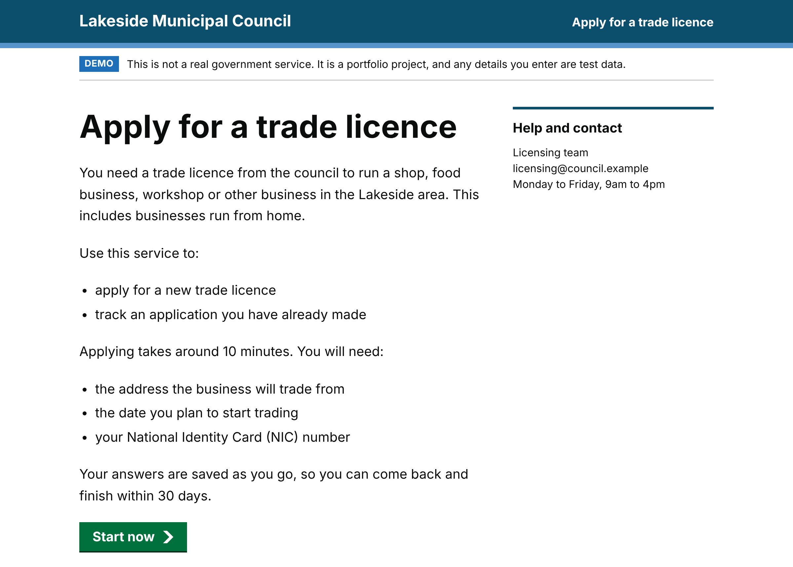
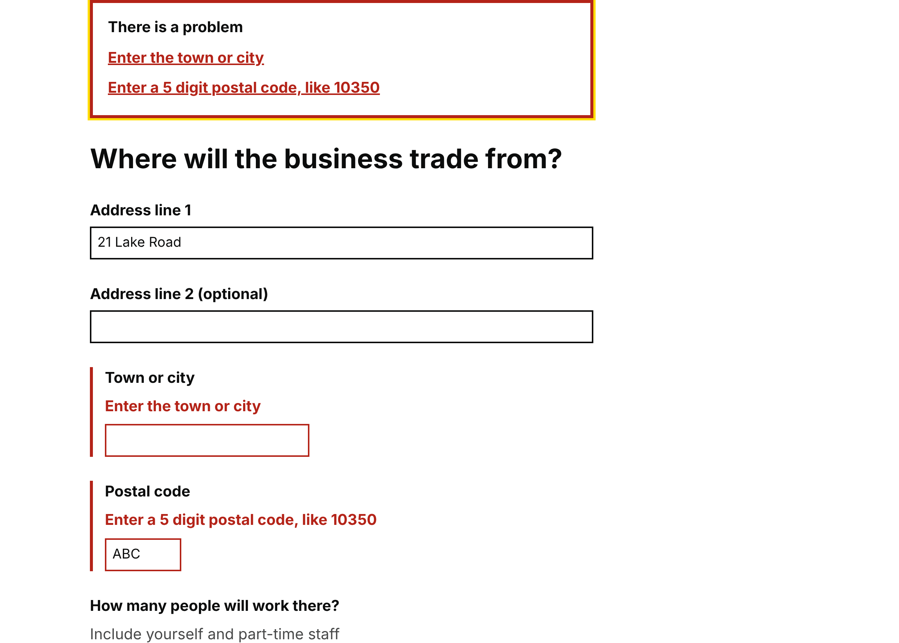
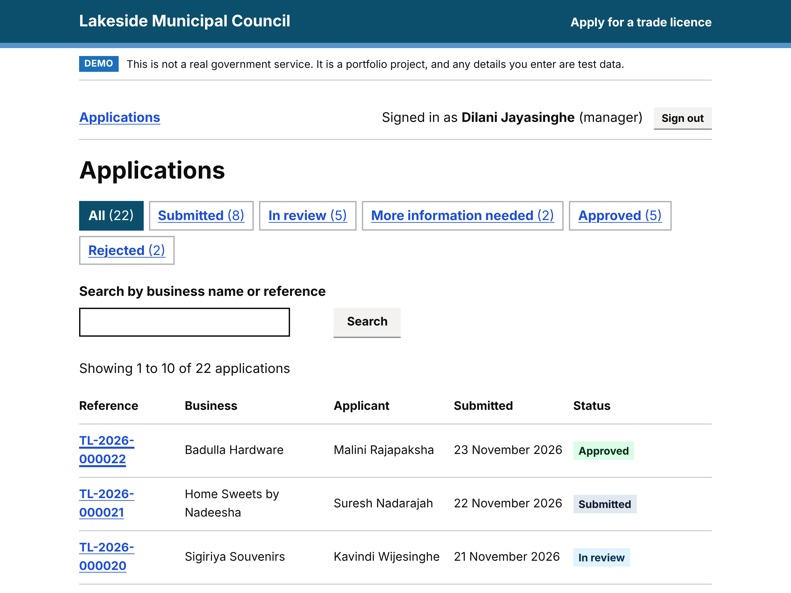
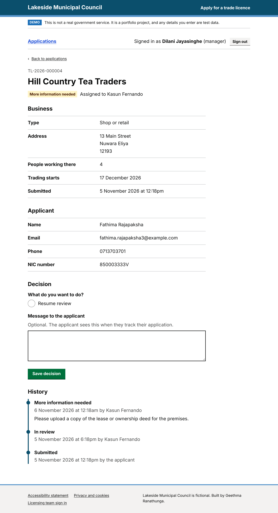
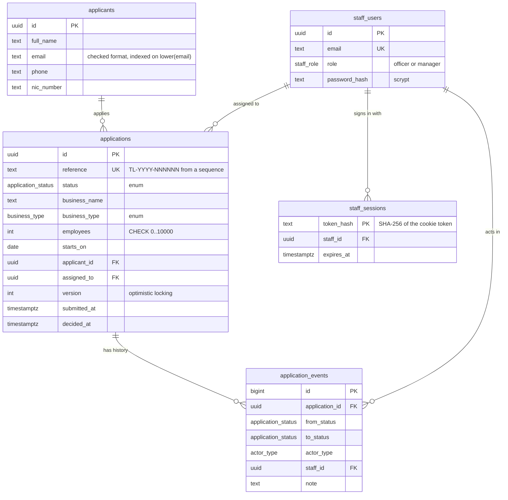
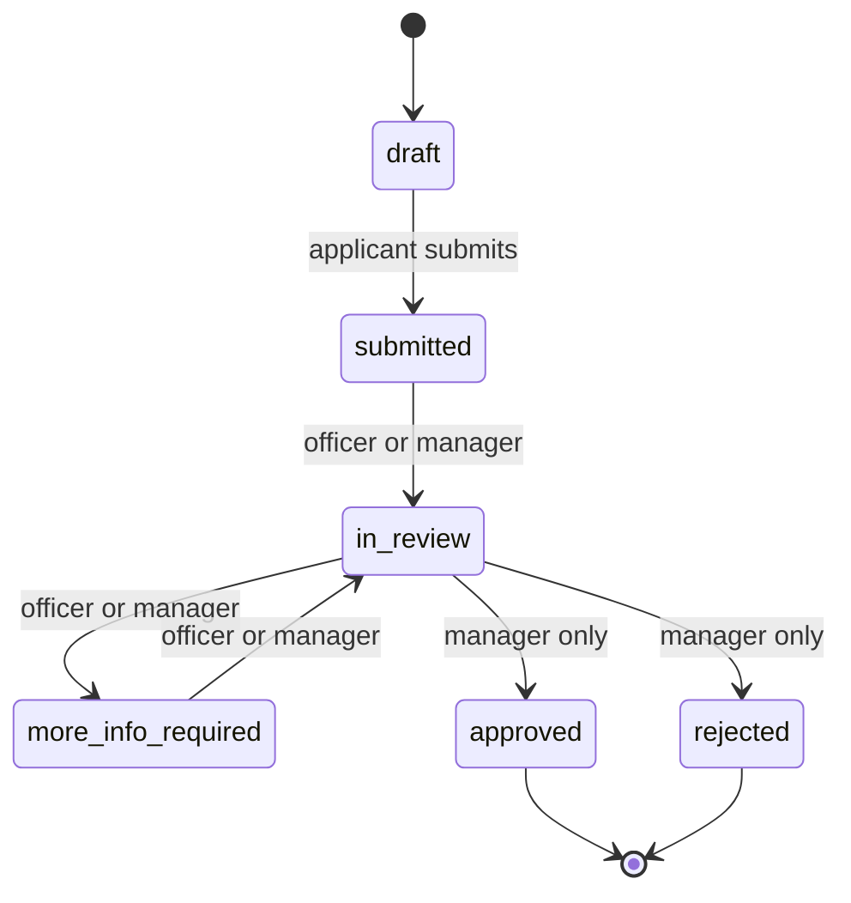

# Apply for a trade licence: an accessible public service

[](https://github.com/Shani67/GovTech-Service-Portal/actions/workflows/ci.yml)

A full stack public service for a fictional council, built the way government digital services are built: one question per page, plain English, works without JavaScript, and tested against WCAG 2.2 AA. Behind it is a PostgreSQL database that enforces the business rules itself, so the data stays correct even if the application code has a bug.

> **Demo only.** Lakeside Municipal Council is fictional and this is not a real government service.



## What it does

**For citizens**

- Apply for a trade licence in four short steps. Answers are saved to a draft after every page.
- Check your answers, change any of them, and submit to get a reference like `TL-2026-000042`.
- Track the application with the reference and email address, and read messages from the council.

**For council staff**

- Sign in to a licensing team area.
- Work through a queue with status filters, search and pagination.
- Review an application and record a decision. Officers can review and ask for more information. Only managers can approve or reject.
- See a full audit history of who changed what and when.

| Error handling                                | Staff queue                                      |
| --------------------------------------------- | ------------------------------------------------ |
|  |  |

<details>
<summary>Application review page with decision form and audit history</summary>



</details>

## Tech stack

Next.js 16 (App Router, server actions), React 19, TypeScript (strict), Tailwind CSS 4, PostgreSQL with Drizzle ORM, PGlite, Zod, Vitest, Playwright and axe-core, GitHub Actions.

## Database design

The database is the source of truth for the rules, not just storage.



### The application workflow



### How the database protects the data

| Rule                                                     | Where it is enforced                                                                                          |
| -------------------------------------------------------- | ------------------------------------------------------------------------------------------------------------- |
| Status can only move along the workflow above            | A `BEFORE UPDATE` trigger ([`0001_workflow_guards.sql`](drizzle/0001_workflow_guards.sql)) and the app        |
| A submitted application has every required answer        | `CHECK` constraint `complete_when_submitted`                                                                  |
| `decided_at` is set only for approved or rejected        | `CHECK` constraint                                                                                            |
| The audit history cannot be edited                       | Trigger that rejects `UPDATE` on `application_events`                                                         |
| References are unique and never reused, even under load  | A Postgres `SEQUENCE` and a unique index                                                                      |
| Two staff cannot overwrite each other's decisions        | Optimistic locking: `UPDATE … WHERE version = $expected`, then a friendly "someone else updated this" message |
| Submitting is all or nothing                             | One transaction with `SELECT … FOR UPDATE`: validate, take a reference, change status, write the audit event  |
| Search cannot be abused with `%` or `_`                  | LIKE wildcards are escaped before `ILIKE`                                                                     |
| Staff passwords and sessions are safe if the table leaks | scrypt password hashes, and only a SHA-256 hash of each session token is stored                               |
| Personal data is not kept forever                        | Drafts untouched for 30 days are deleted, with their applicant details, by a daily cron job                   |

Migrations are plain SQL in [`drizzle/`](drizzle), generated from [`src/db/schema.ts`](src/db/schema.ts) plus one hand-written migration for the triggers. Data access lives in [`src/lib/applications/repository.ts`](src/lib/applications/repository.ts).

### Two ways to run the database

- **PostgreSQL** (production): set `DATABASE_URL`, for example to a free [Neon](https://neon.tech) database.
- **PGlite** (zero setup): with no `DATABASE_URL`, the app runs real Postgres compiled to WebAssembly inside the Node process. It migrates and seeds itself on start. Data is kept in `.data/pglite` during development, and in memory otherwise.

The integration tests use PGlite, so every test runs against real Postgres with the real migrations, triggers and constraints, and needs no Docker. CI also runs the end-to-end tests against a PostgreSQL 17 server.

## Accessibility

Built to meet WCAG 2.2 AA, following patterns from public sector design systems:

- One question or one group of questions per page, with clear labels and hints.
- An error summary that takes focus, links to each field, and adds "Error:" to the page title.
- Errors, hints and inputs connected with `aria-describedby` and `aria-invalid`.
- Dates as separate day, month and year fields, so any keyboard and screen reader can use them.
- A skip link, landmarks, one `h1` per page and unique page titles.
- A high-contrast yellow focus style on every interactive element.
- Status changes announced with `role="status"` and live regions.
- Every form works with JavaScript turned off (server actions with progressive enhancement).
- Reflows at 320px wide without horizontal scrolling.

Automated tests check every page with axe-core on desktop and mobile. Automated tools catch only part of the problems, so this has not replaced a manual audit or testing with disabled users. See the [accessibility statement](src/app/accessibility/page.tsx).

## Run it locally

You need Node.js 22.

```bash
npm install
npm run dev
```

Open http://localhost:3000. No database setup is needed. To try the staff area, go to `/staff` and sign in as `officer@council.example` or `manager@council.example` with the password `demo-password`.

To use PostgreSQL instead, copy `.env.example` to `.env.local`, set `DATABASE_URL`, then run:

```bash
npm run db:migrate
npm run db:seed
```

## Tests

```bash
npm test            # 33 unit and database integration tests (Vitest + PGlite)
npm run test:e2e    # 60 end-to-end and accessibility tests (Playwright + axe, desktop and mobile)
npm run lint
npm run typecheck
```

The end-to-end tests cover the full application journey with and without JavaScript, error handling, tracking, the officer and manager workflow, a simultaneous-edit conflict, sign out, and axe checks on every page.

## Deploy

1. Create a free Postgres database on [Neon](https://neon.tech) and copy its connection string.
2. Import this repository on [Vercel](https://vercel.com) and add the environment variables:
   - `DATABASE_URL`: the Neon connection string
   - `STAFF_DEMO_PASSWORD`: the password for the demo staff accounts
   - `CRON_SECRET`: any long random string, used by the daily clean-up job
3. Deploy. The `vercel-build` script applies migrations and seeds the demo data before building.

## Project structure

```
drizzle/                 SQL migrations (schema, triggers)
scripts/                 migrate and seed commands
src/db/                  schema, database client, PGlite setup, seed data
src/lib/applications/    validation, workflow rules, repository (all SQL lives here)
src/lib/staff/           password hashing and sessions
src/app/apply/           the application journey
src/app/track/           tracking an application
src/app/staff/           the licensing team area
e2e/                     Playwright and axe tests
```

## Licence

MIT © Geethma Ranathunga
